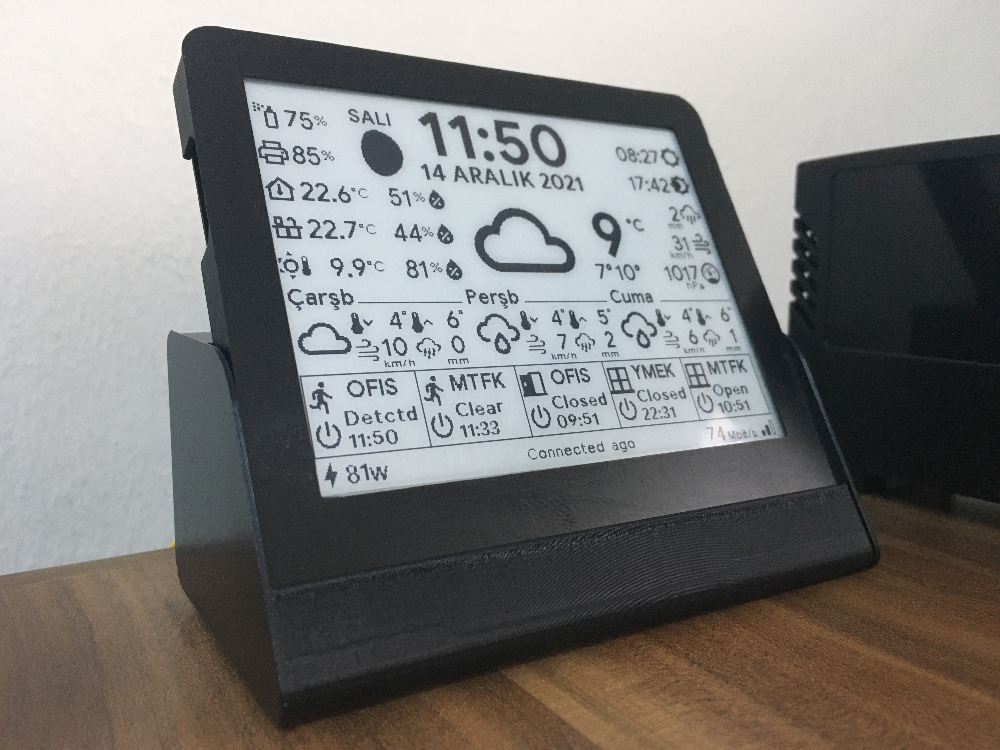
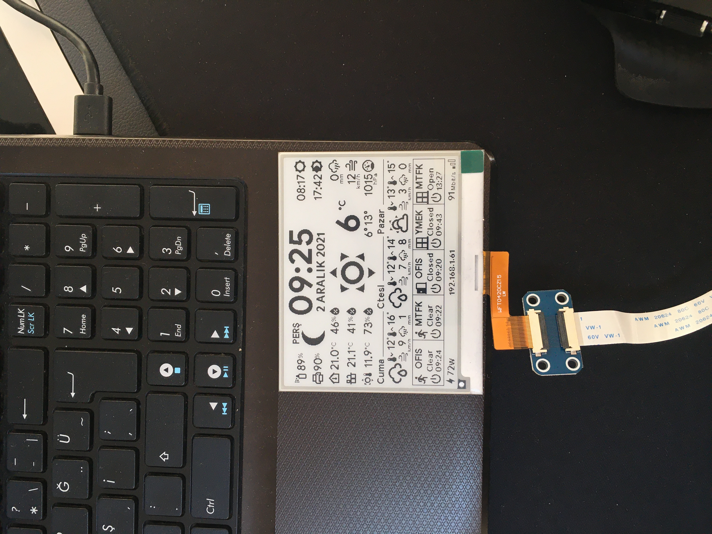
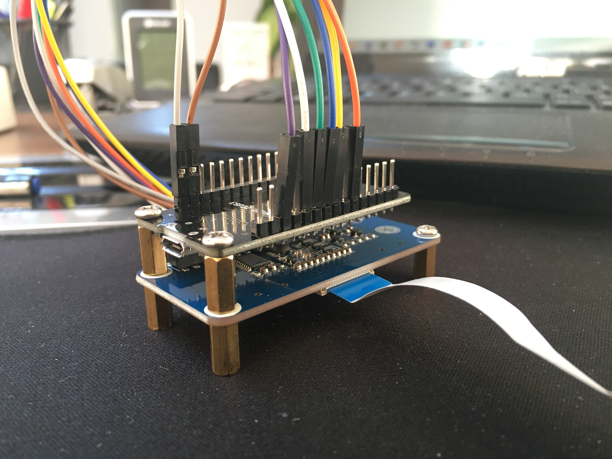
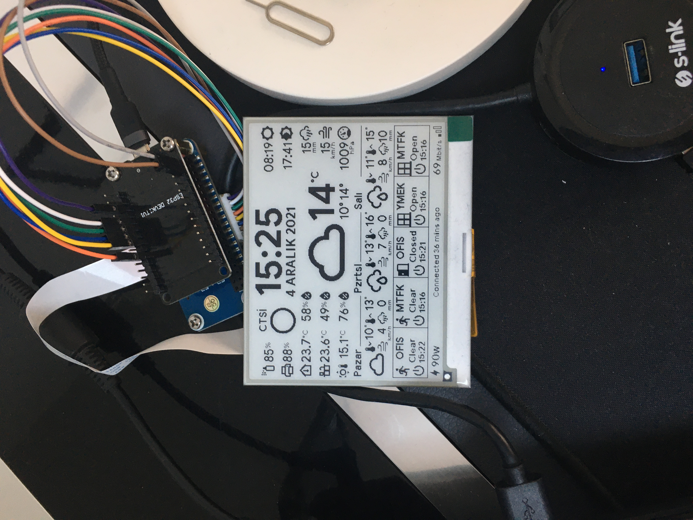
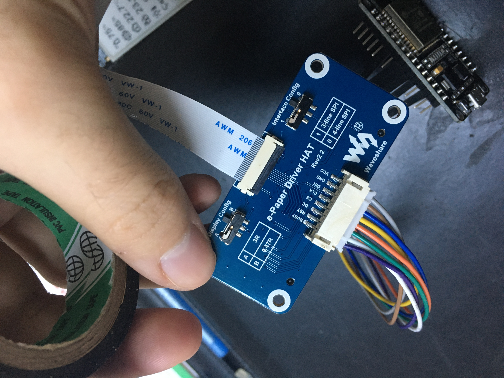
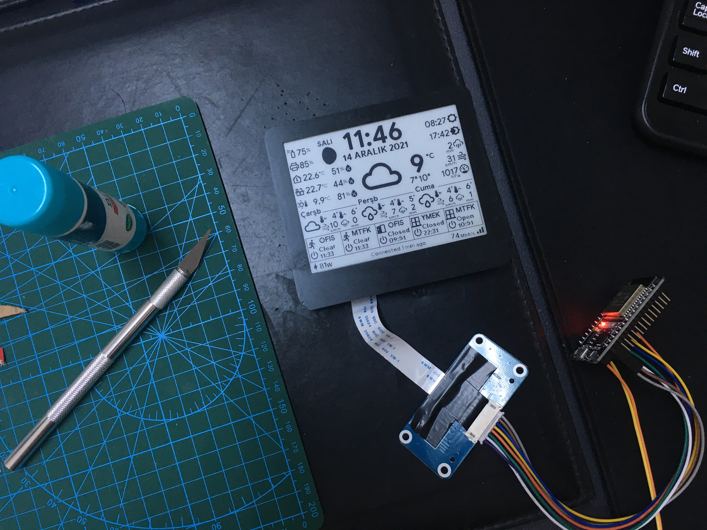
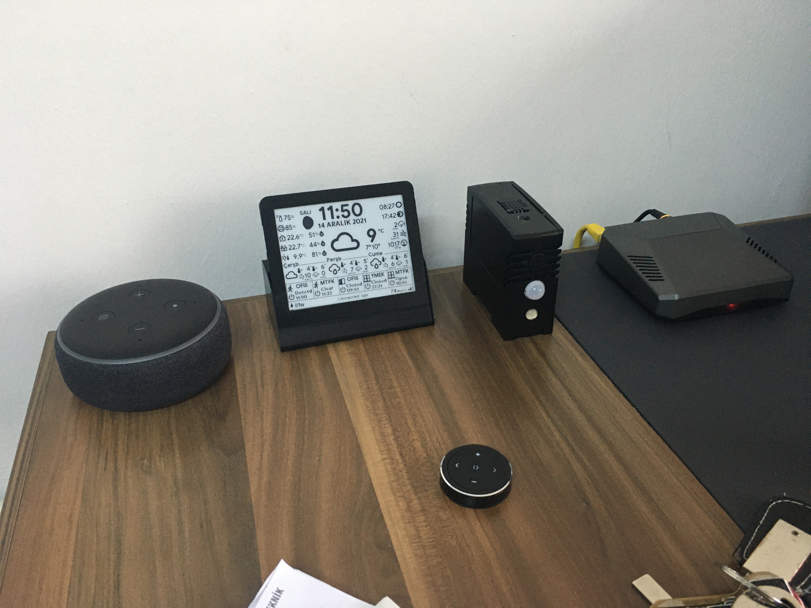
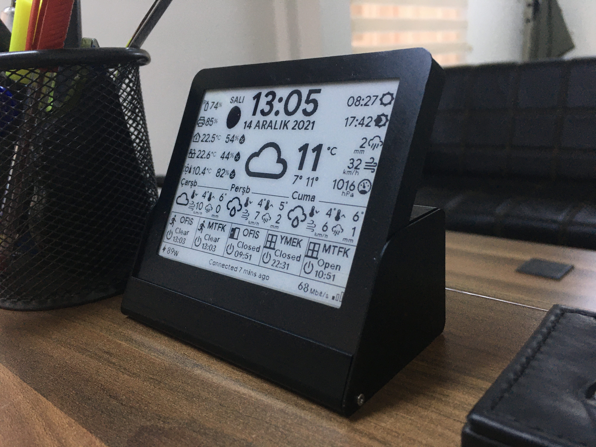
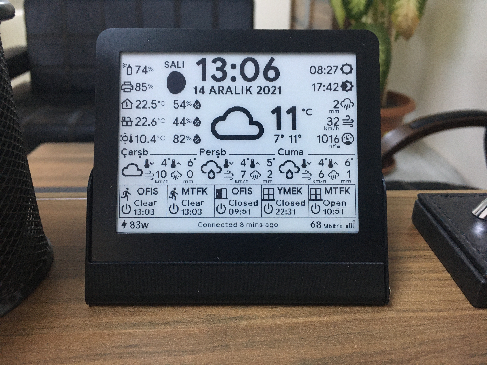
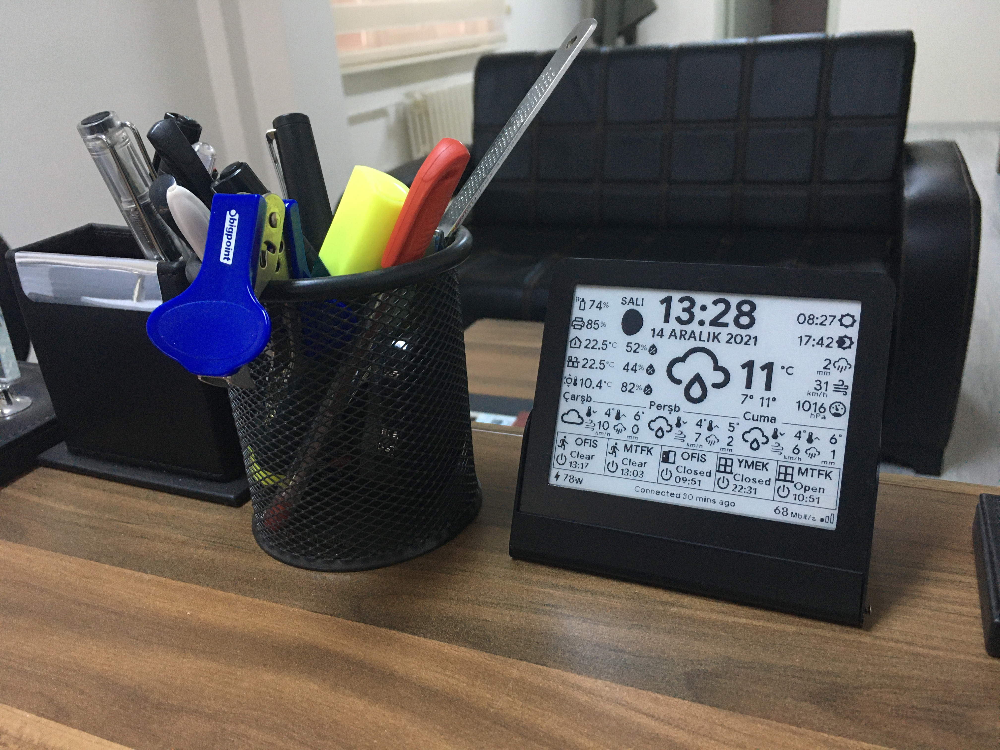

<div align="center">

# ESP32Display

**A DIY ESP32 + Waveshare e-paper dashboard for Home Assistant office and weather data.**


</div>

<p align="center">
  
</p>

**ESP32Display** is a low-power, always-visible office dashboard built with an **ESP32-WROOM-32**, a **Waveshare 4.2-inch 400×300 e-paper display**, **ESPHome**, and **Home Assistant** sensors.

It was mostly inspired by the excellent e-paper display projects shared in the Home Assistant community:

<p align="center">
  <a href="https://community.home-assistant.io/t/e-paper-display/">Home Assistant Community — E-paper display thread</a>
</p>

---

## At a glance

- **Display:** Waveshare 4.2-inch raw e-paper panel, 400×300 resolution
- **Controller:** ESP32-WROOM-32 Lua development board
- **Firmware:** ESPHome with custom display rendering in YAML/C++ lambdas
- **Data source:** Home Assistant sensors, binary sensors, weather entities, and template sensors
- **Use case:** Office weather, environment, motion/door/window, power, uptime, and network status display
- **Case:** 3D printed enclosure based on [Thingiverse model 4772071](https://www.thingiverse.com/thing:4772071)

---

## Gallery

### Finished dashboard and build photos

<p align="center">
  
  
  
</p>

<p align="center">
  
  
  
</p>

### Size comparison

<p align="center">
  
  
  
  
</p>

---

## What the display shows

The layout is rendered directly in ESPHome using the Waveshare e-paper display component, Google Sans fonts, and Material Design Icons.

Depending on the YAML version and the Home Assistant entities available in your setup, the dashboard can show:

- Current time, full date, and Turkish day name
- Sunrise and sunset times
- Moon phase icon
- Current weather condition icon
- Outside temperature, forecast low/high, precipitation, wind speed, and pressure
- 3-day forecast with day names, icons, temperature, wind, and precipitation values
- Office, kitchen, and outside temperature/humidity values
- Motion, door, and window sensor states with last-change times
- Air freshener and printer/toner percentage values
- Power consumption
- ESP32 uptime
- Download speed and Wi-Fi signal indicator
- Optional mouse battery and door-lock information in the newer YAML version

---

## How it works

```text
Home Assistant sensors/templates
        │
        ▼
ESPHome homeassistant sensors/text_sensors
        │
        ▼
ESP32-WROOM-32
        │  SPI + control pins
        ▼
Waveshare 4.2" e-paper display
```

The `configuration.yaml` file contains Home Assistant template sensors for date formatting, forecast values, sunrise/sunset, last-change times, and uptime formatting. The ESPHome YAML files consume those entities through `homeassistant` sensors and draw the screen using custom display lambda code.

---

## Hardware used

- Waveshare 4.2-inch, 400×300 raw e-paper display
- Waveshare Universal e-Paper Raw Panel Driver HAT
- ESP32-WROOM-32 Lua development board
- 3D printed case  
  [Thingiverse model](https://www.thingiverse.com/thing:4772071)

---

## Software stack

- [Home Assistant](https://www.home-assistant.io/)
- [ESPHome](https://esphome.io/)
- Waveshare e-paper display support in ESPHome
- Home Assistant template sensors for date, forecast, uptime, and last-change information
- Custom fonts and Material Design Icons included in this repository

---

## Repository contents

```text
.
├── README.md
├── configuration.yaml
├── esp32display.yaml
├── esp32displaynewversion28112024.yaml
├── fonts/
│   ├── Google_Sans_Bold.ttf
│   ├── Google_Sans_Medium.ttf
│   └── materialdesignicons-webfont.ttf
├── images/
│   ├── IMG_0275.JPG
│   ├── IMG_0276.JPG
│   ├── IMG_0280.JPG
│   ├── IMG_0304.JPG
│   ├── IMG_0305.JPG
│   ├── IMG_0309.JPG
│   ├── IMG_0310.JPG
│   ├── IMG_0314.JPG
│   ├── IMG_0316.JPG
│   └── IMG_0317.JPG
└── secrets.yaml
```

### Main files

- `esp32display.yaml` — original ESPHome configuration for the ESP32 e-paper dashboard.
- `esp32displaynewversion28112024.yaml` — newer ESPHome configuration version dated 28.11.2024, with updated entities, newer OTA syntax, and additional mouse/lock information.
- `configuration.yaml` — Home Assistant template sensors used by the display, including date, forecast, sunrise/sunset, motion times, and uptime formatting.
- `fonts/` — Google Sans and Material Design Icons font files used by the display layout.
- `images/` — build photos and size-comparison photos.
- `secrets.yaml` — example secret placeholders for Wi-Fi and ESPHome passwords.

---

## Display wiring / pin configuration

The ESPHome configuration defines the e-paper SPI and control pins through substitutions:

```yaml
substitutions:
  devicename: ESP32Display
  gpio_spi_clk_pin: GPIO25
  gpio_spi_mosi_pin: GPIO26
  gpio_cs_pin: GPIO32
  gpio_busy_pin: GPIO13
  gpio_reset_pin: GPIO14
  gpio_dc_pin: GPIO27
```

The SPI bus is configured as:

```yaml
spi:
  clk_pin: $gpio_spi_clk_pin
  mosi_pin: $gpio_spi_mosi_pin
  id: epaper_display
```

And the Waveshare display component uses:

```yaml
display:
  - platform: waveshare_epaper
    id: epaper
    cs_pin: $gpio_cs_pin
    busy_pin: $gpio_busy_pin
    reset_pin: $gpio_reset_pin
    dc_pin: $gpio_dc_pin
    model: 4.20in
```

The original YAML refreshes every `60s`; the newer YAML refreshes every `30s`.

---

## Home Assistant integration

Most values shown on the display come from Home Assistant entities. The ESPHome YAML files pull those values using `homeassistant` sensors and text sensors.

Examples include:

- Weather entities and forecast template sensors
- Temperature and humidity sensors
- Motion, door, and window binary sensors
- Printer/toner and air freshener percentage sensors
- Speedtest/download sensor
- Power consumption sensor
- Sun, moon, date/time, and uptime template sensors
- Optional mouse battery and smart-lock entities in the newer YAML version

The included `configuration.yaml` contains template sensors such as:

- `sensor.turkishdayname`
- `sensor.fulldate`
- `sensor.day_1_*`, `sensor.day_2_*`, `sensor.day_3_*`
- `sensor.sun_rising_template`
- `sensor.sun_setting_template`
- Last-change time sensors for motion, doors, and windows
- `sensor.esp32display_uptime_template`

---

## Customization notes

Before using this project in another Home Assistant setup, review and update the entity IDs in the YAML files.

You will likely need to customize:

- Wi-Fi secrets
- ESPHome OTA password
- Fallback hotspot password
- Timezone
- Weather entity
- Temperature/humidity sensor entity IDs
- Motion, door, and window entity IDs
- Printer, air freshener, power, speedtest, mouse, lock, and other optional sensor entity IDs
- Display labels if you want to use different room names or another language
- Font paths if your ESPHome directory layout is different

The display code uses fonts from this repository:

```text
fonts/Google_Sans_Bold.ttf
fonts/Google_Sans_Medium.ttf
fonts/materialdesignicons-webfont.ttf
```

Make sure these files are available in your ESPHome project directory when compiling/flashing.

---

## YAML versions

There are two ESPHome YAML files in this repository:

- `esp32display.yaml` — earlier/original configuration using the original weather/entity references and `60s` update interval.
- `esp32displaynewversion28112024.yaml` — newer version dated 28.11.2024, with updated entity references, newer ESPHome OTA platform syntax, `30s` update interval, and additional mouse/door-lock display fields.

---

## Credits

- Inspired by the Home Assistant community e-paper display projects:  
  [https://community.home-assistant.io/t/e-paper-display/](https://community.home-assistant.io/t/e-paper-display/)
- 3D printed case model:  
  [https://www.thingiverse.com/thing:4772071](https://www.thingiverse.com/thing:4772071)
- Built with ESPHome, Home Assistant, ESP32, and Waveshare e-paper hardware.

---

## Disclaimer

This is a personal DIY project shared as a reference for similar Home Assistant e-paper dashboards. The configuration is specific to the original office setup, so entity IDs, secrets, sensors, fonts, and layout details will need to be adjusted for your own installation.
